# What is CoursePilot

CoursePilot is a study assistant for a university programme's teaching material. Faculty upload lecture slides, PDFs, notes and handouts into a fixed structure of **Year › Block › Module** (by default 3 years, each with 3 blocks, each with 3 modules, so 27 modules). Students then chat with an assistant that:

- answers **from the uploaded material first**, and shows exactly which document and page or slide each statement came from (citations such as `[C1]`);
- only when the material is not enough, searches the internet and says **clearly** that the answer, or part of it, comes from the web, with links (citations such as `[W1]`);
- says so plainly when it cannot find anything, instead of inventing sources.

CoursePilot runs as a web site. Everyone signs in with an account created by an administrator; there is no self-registration.

**Roles**

| Role | What they can do |
|---|---|
| **Student** | Chat, search, read cited passages and download documents |
| **Faculty** | Everything a student can, plus upload, delete and re-index material, and edit module titles, descriptions and the web-search setting |
| **Administrator** | Everything a student can, plus manage users, rename years and blocks, and watch jobs and usage. Administrators do not upload material |
| **Guest** (no account) | Joins with a temporary **module access code** from faculty or an administrator. Can chat, search and read cited passages in that one module until the code expires. Cannot download files or see anything else |

> **Note.** Every signed-in user with an account can search and read **all** uploaded material. There are no per-module permissions for accounts. Guests are the exception: they see only the one module their code was issued for. Conversations, however, are private to their owner (not even administrators can open them).

> **About the screenshots.** The screenshots in this manual come from a demo installation with sample users (Dr. Amina Admin, Prof. Farah Khan and Sara Ahmed). The AI answers shown in them come from a test model and are **examples only**; real answers come from the AI provider you configure.

Throughout this manual, a line such as **Who: Students, Faculty** tells you which roles a section is for.

# Installation and first-time setup

**Who: whoever installs CoursePilot (usually the administrator or IT).**

## Requirements

- A computer running **Windows, macOS or Linux**.
- **Python 3.12** is needed, but you do not have to install it beforehand: setup checks for the package manager `uv` and for Python 3.12. If either is missing, it explains what it would do and asks before installing it (see "Running the setup"). If you prefer to install Python yourself, get 3.12 from [python.org](https://www.python.org/downloads/) (on Windows, tick "Add Python to PATH").
- An **internet connection**, because the AI providers (chat model, embeddings and optionally web search) are cloud services.
- At least one **API key**: one for the chat model (Anthropic Claude or Google Gemini) and one for embeddings (Gemini, Voyage or OpenAI). A Gemini key can serve both. A Tavily key for web search is optional.
- No Docker, no Node.js, no database server. Setup installs everything with Python tools.

These are the requirements to try CoursePilot. For server sizing and the three ways to run it (on-premises with cloud AI, on-premises with local AI, or fully in the cloud), see **Deployment options and system requirements** below.

## Getting the code

Either:

1. **Clone with git:** `git clone <repository address> CoursePilot`, or
2. **Download a release zip** (`coursepilot-vX.Y.Z.zip`) and unzip it into a folder, for example `C:\CoursePilot` or `~/coursepilot`.

## Running the setup

Open a terminal in the CoursePilot folder and run:

```
setup.bat          (Windows)
./setup.sh         (macOS / Linux)
```

The script looks for the package manager `uv` and for Python 3.12. If both are present (the usual case on a developer machine) it asks nothing extra: it installs the dependencies and then starts the interactive questions below. Press **Enter** to accept the value shown in `[brackets]`.

Setup never installs anything without a **yes**. There are at most two extra questions, each answered with `y` (Enter means no):

- **"Run it now? [y/N]"** (only when `uv` is missing). If a Python is already installed, setup first tries `pip install --user uv`. Otherwise it shows the command of the official installer from astral.sh and asks before running it; `uv` goes into your user folder (`.local/bin`), not into the system.
- **"Download Python 3.12 now? [y/N]"** (only when no Python 3.12 is found). `uv` downloads a private Python 3.12 just for CoursePilot; a Python you already have is left untouched.

If you answer no, setup stops and prints how to install `uv` or Python 3.12 yourself; run it again afterwards. `start.bat` / `./start.sh` find the same `uv`, so they also work when Python came only from `uv`.

If SQLite on the computer lacks a needed feature, setup stops and explains what is missing.

## The setup questions, step by step

Setup asks the questions in this order.

1. **Port for the web app.** The port the site listens on (default `8000`). Enter a number from 1 to 65535.
2. **Network setting.** Setup first prints whether the current setting is "this computer only" or "other computers may connect without HTTPS". It then asks: *"Will other computers connect to this machine over the network without HTTPS?"*
    - **n** (default): only this computer can open the site, at `http://localhost:<port>`.
    - **y**: other computers on your network can connect. Setup prints a warning: without HTTPS, passwords and session cookies cross the network in clear text, so use this **only on a closed network you trust**. It then asks *"Address other computers will type in their browser"*. Enter the machine's network address as `http://HOST:PORT`, for example `http://192.168.1.20:8000`. `localhost` is not accepted here. See "Choosing the network address" below.
3. **Session secret.** If there is no strong `SECRET_KEY` yet, setup generates one automatically ("Generated a new SECRET_KEY."). An existing strong key is never replaced.
4. **Chat AI provider** (`anthropic`, `gemini`, then, for testing, `ollama` or `openai_compatible`). Default `anthropic`; Anthropic and Gemini remain the recommended choice. The two local options run a model on your own hardware: see "Option 2" below. For `ollama` setup asks for the Ollama address (default `http://localhost:11434`); for `openai_compatible` it asks for the server address including `/v1` and an optional key (hidden). It also warns that local models can be slow and suggests raising `AGENT_TIMEOUT_S`.
5. **Chat model** and **Fast model.** Prefilled with the provider's defaults (Anthropic: `claude-sonnet-5-5` and `claude-haiku-5-5`; Gemini: `gemini-2.5-flash` for both; Ollama: `qwen2.5:7b-instruct` for both, so pull it first; `openai_compatible` has no default, you type the name your server uses). The fast model is a cheaper one used for rewriting follow-up questions and quick checks. Press Enter to accept.
6. **API key for the chat provider** (Anthropic and Gemini only; local providers need none). The input is hidden. Enter the key, press Enter to keep the current one, type `-` to clear it, or leave it empty to skip. You can skip and add it later, but the chat will say "AI provider not configured" until a key is set.
7. **Embedding provider** (`gemini`, `voyage`, `openai`, then, for testing, `ollama`, `openai_compatible` or `local`). Default `gemini`. Embeddings turn text into numbers so the system can find passages by meaning. Anthropic has no embeddings service, so Claude users pick one of these separately. If you chose Gemini for chat, setup tells you the Gemini key is shared and asks for it only once.
8. **Embedding model** and **Embedding dimension.** Defaults: Gemini `gemini-embedding-001` / 768, Voyage `voyage-3.5` / 1024, OpenAI `text-embedding-3-small` / 1536, Ollama `nomic-embed-text` / 768, `local` `BAAI/bge-small-en-v1.5` / 384. For `openai_compatible` you type the model and its dimension. Other good local models: `bge-m3` and `mxbai-embed-large` (both 1024). For `ollama` and `openai_compatible` setup then asks for the server address; for `local` it explains the 1-2 GB PyTorch download and offers to install it now.
9. **API key for the embedding provider** (hidden, same rules as step 6), unless it is the shared Gemini key.
10. **Tavily web search API key** (optional, hidden). Only needed if the assistant may search the internet when the material cannot answer. Only the search query is sent to Tavily. Without a key, the assistant answers from the material only and says that web search is not configured.
11. Setup writes the `.env` file, brings the database up to date, creates the programme structure (Years, Blocks and Modules), and, if no administrator exists yet, asks you to **create the first administrator**:
    - **Admin email**
    - **Display name** (default "Administrator")
    - **Password (min 10 characters, hidden)**, then **Repeat password**. You have 3 attempts.

**Password rules.** At least 10 characters; not only spaces; not the same as your email or the part before the `@`; and not on the built-in list of very common passwords.

### Example setup session

The text below is an **example** with placeholder values. Your output will differ slightly, and the keys you type are hidden on screen.

```text
C:\CoursePilot> setup.bat
...installing dependencies...
CoursePilot setup. Press Enter to accept the value in [brackets].
Port for the web app [8000]:
Current network setting: this computer only.
Will other computers connect to this machine over the network without HTTPS? [y/N]:
Generated a new SECRET_KEY.
Chat AI provider (anthropic/gemini/ollama/openai_compatible) [anthropic]: gemini
Chat model [gemini-2.5-flash]:
Fast model [gemini-2.5-flash]:
Gemini API key (optional) [(not set)] (Enter keeps it, '-' clears it, empty skips):
Gemini chat and Gemini embeddings share GOOGLE_API_KEY, so it is asked only once.
Embeddings are independent of the chat model (Anthropic has no embeddings API).
Embedding provider (gemini/voyage/openai/ollama/openai_compatible/local) [gemini]:
Embedding model [gemini-embedding-001]:
Embedding dimension [768]:
Note: changing the embedding provider, model or dimension later (after material was
processed) requires 'python -m app.cli reindex-all'.
Web search (optional): only when the uploaded material cannot answer a question, ...
Tavily web search API key (optional) [(not set)] (Enter keeps it, '-' clears it, empty skips):
Wrote C:\CoursePilot\.env.
Database is up to date.
Programme structure ready (36 new rows).
Create the first administrator account.
Admin email: admin@example.edu
Display name [Administrator]: Dr. Admin
Password (min 10 characters, hidden):
Repeat password:
Created administrator admin@example.edu.
Setup complete. Start CoursePilot with start.bat (Windows) or ./start.sh.
```

(The "36 new rows" in this example is 3 years + 9 blocks + 27 modules, the default structure.)

## Choosing the network address (only if others will connect)

If you answered **yes** to the network question:

1. Find this computer's IPv4 address. On Windows open a terminal and run `ipconfig`, then look for **IPv4 Address** under your active network adapter (for example `192.168.1.20`). On macOS/Linux use `ip addr` or `ifconfig`.
2. Type the address with the port, for example `http://192.168.1.20:8000`.
3. Give this computer a **fixed (static or reserved) address** in your router or network settings. If the address changes, the saved address no longer works; run setup again to update it.
4. **Everyone must type exactly that address** in their browser. CoursePilot checks the address on every change you make in the site, so reaching it by a different name or address (for example by computer name instead of the IP) can produce a "forbidden" error. See the Troubleshooting chapter.
5. If a firewall is on, allow the chosen port for your local network only. Never expose this setup to the internet.

When this mode is on, administrators see a banner on every page: "Traffic to this server is not encrypted (ALLOW_INSECURE_HTTP=true)." For use beyond a trusted closed network, put CoursePilot behind HTTPS; see `docs/deploy.md`.

## Running setup again

You can run setup again at any time (for example to change a key or the network setting). Existing values are shown as defaults, so pressing **Enter** keeps them. API keys are never printed in full: they are shown masked, for example `****a1b2`, or `(not set)`. Type `-` to clear a key. Comments and unknown lines in `.env` are preserved, and an existing strong secret key is kept. Every start (`start.bat` / `./start.sh`, and `serve`) and every setup run refreshes `.env` from the template `.env.example`: all options are listed with explanations and their possible values, your values and keys are kept, your own extra settings are kept at the end under "Other settings kept from your previous .env", and your own comment lines are replaced by the standard ones. If you change the embedding settings, setup reminds you to re-index existing material (see Troubleshooting).

## What setup writes

- **`.env`** at the top of the CoursePilot folder: all settings and keys. It is created readable by its owner only. **Never share or commit it**, and keep a copy in a password manager.
- **`data/`**: the database files and uploaded documents (created when the app first runs).
- **`backend/.venv/`**: the installed Python packages.

# Starting and stopping

**Who: whoever runs the server.**

## Starting

```
start.bat          (Windows)
./start.sh         (macOS / Linux)
```

This brings the database up to date (migrations), starts the **web app** and the background **worker** (which processes uploaded files), waits until the site answers, and **opens your browser** at the configured address, normally `http://localhost:8000`. Keep the terminal window open while people use CoursePilot.

Example console output (**example**; logging lines vary):

```text
CoursePilot is starting at http://localhost:8000 (Ctrl+C to stop)
(worker and web app log lines appear here)
```

Both processes are needed: without the worker, uploaded documents stay "Queued" forever.

## Stopping

Press **Ctrl+C** in the terminal. The web app stops and the worker is shut down gracefully; a job that was in progress is picked up again next time.

## Changing keys or settings later

1. Stop CoursePilot (Ctrl+C).
2. Run `setup.bat` / `./setup.sh` again, press Enter to keep what is fine and change what you need. (You can also edit `.env` by hand: each option in it has a comment explaining its choices.)
3. Start again with `start.bat` / `./start.sh`.

## Where your data lives, and backups

Everything is in the `data/` folder next to `.env`: `coursepilot.db` (users, structure, documents' text index, conversations), `checkpoints.db` (chat memory) and `files/` (the uploaded originals). Keep it on a local disk, not a network share.

To make a backup (safe while the app runs), from the `backend` folder:

```
python -m uv run python -m app.cli backup
```

Options: `--out DIR` to choose the destination and `--keep N` to keep only the last N backups. A dated folder with both databases, the uploaded files and a checksum manifest is created. The backup does **not** include `.env`; copy that separately. To restore, stop the app and worker, then run `python -m uv run python -m app.cli restore <backup folder>` (it verifies checksums and asks for confirmation). Production deployments (HTTPS, services, schedules) are covered in `docs/deploy.md`.

# Deployment options and system requirements

**Who: whoever decides where CoursePilot runs (usually IT or the administrator).**

CoursePilot can be run in three ways. They differ in **where the application runs** and **where the AI models run**. In all three, the database and the uploaded files stay on the server that runs CoursePilot (or, optionally, files in your own Cloudflare R2 bucket).

| | Option 1: On-premises, cloud AI | Option 2: On-premises, local AI | Option 3: Everything in the cloud |
|---|---|---|---|
| **Application runs on** | Your own computer or server | Your own server with a GPU | A rented cloud server (VPS) |
| **AI models** | Anthropic Claude or Google Gemini (cloud APIs) | Open models on your own hardware | Anthropic Claude or Google Gemini (cloud APIs) |
| **What leaves your network** | Questions, retrieved passages and document text for embedding go to the AI provider; web-search queries go to Tavily | Nothing, if web search is off | Everything is hosted outside; the same AI traffic as option 1 |
| **Status** | **Available now** | **Available for testing** (Anthropic/Gemini remain the recommended default) | **Available now**, as a service or as a Docker container |
| **Best for** | Most universities; quick start | Strict data-protection rules, no cloud AI allowed | No local server; access from anywhere over HTTPS |

> **The figures below are sizing guidance**, not guarantees. They assume one programme (27 modules) with up to a few thousand documents and up to about 100 students chatting at the same time. Start with the "recommended" column and watch the **Usage** and **Jobs** pages.

## Option 1: On-premises with cloud AI models

CoursePilot runs on a machine you control (a Windows or Linux server, or even a desktop PC for a small group). The chat model (Anthropic Claude or Google Gemini), the embeddings (Gemini, Voyage or OpenAI) and the optional web search (Tavily) are cloud services reached over the internet. This is how CoursePilot works today, set up with `setup.bat` / `./setup.sh` as described above.

| | Minimum | Recommended |
|---|---|---|
| **CPU** | 2 cores | 4 cores |
| **Memory (RAM)** | 4 GB | 8 GB (16 GB if faculty often upload books of 1,000+ pages) |
| **Disk** | 20 GB SSD | 100 GB SSD; allow about **2.5 x** the size of the uploaded material (originals + index), plus space for backups |
| **GPU** | Not needed | Not needed |
| **Operating system** | Windows 10/11 or Server 2019+, Ubuntu 22.04/24.04 or another current Linux, macOS 13+ | A server OS, running as a service (see `docs/deploy.md`) |
| **Software** | Python 3.12 | Python 3.12; Caddy for HTTPS when others connect |
| **Network** | Outbound HTTPS (port 443) to the AI providers and Tavily | The same, plus a fixed address or host name for users |

Notes:

- The heavy work (understanding questions and writing answers) happens at the AI provider, so a modest server is enough. Uploads are the only CPU-heavy moment: a 1,000-page PDF is parsed in a few minutes and briefly uses up to 1-2 GB of memory.
- Keep the `data/` folder on a **local SSD**, never on a network share.
- Costs are mostly the AI provider's per-token charges, not hardware. See **Usage** for tokens per day.

## Option 2: On-premises with local AI models (for testing)

> **Available for testing.** Anthropic and Gemini remain the recommended choice: they give the best answers with the least effort. Use local models when no question or document may leave your network, or to try CoursePilot without API costs. Quality and speed depend on your model and hardware; test on your own material first.

Everything, including the AI, runs on your own hardware, for example with **Ollama** serving an open chat model (such as Llama, Qwen, Mistral or Gemma) and a local embedding model. With web search turned off (`WEB_SEARCH_PROVIDER=none`), no question or document leaves your network.

### How to set it up

1. **Install Ollama** on the machine that has the GPU (ollama.com). It can be the same machine as CoursePilot or another one on your network.
2. **Pull a chat model and an embedding model**, for example `ollama pull qwen2.5:7b-instruct` and `ollama pull nomic-embed-text` (see ollama.com/library for current models; bigger models need more GPU memory, see the table below).
3. **Run setup** (`setup.bat` / `./setup.sh`) and choose `ollama` as the chat provider and as the embedding provider, or edit `.env` by hand: `LLM_PROVIDER=ollama`, `LLM_MODEL` and `LLM_FAST_MODEL` (the same model is fine), `EMBEDDING_PROVIDER=ollama`, `EMBEDDING_MODEL=nomic-embed-text`, `EMBEDDING_DIM=768`, and `OLLAMA_BASE_URL` if Ollama is on another machine.
4. **Re-index if the embedding model changed.** If material was already processed with another embedding model, stop CoursePilot and run `python -m uv run python -m app.cli reindex-all` from the `backend` folder; until then search reports an index mismatch.
5. **Allow more time.** Local models are slower, especially on a CPU. Raise `AGENT_TIMEOUT_S` in `.env` (for example to `300`).

Other servers: anything that speaks the OpenAI API works with `LLM_PROVIDER=openai_compatible` (vLLM, LM Studio, the llama.cpp server, LocalAI): set `LOCAL_LLM_BASE_URL` (including `/v1`), optionally `LOCAL_LLM_API_KEY`, and the model name. For embeddings use `EMBEDDING_PROVIDER=openai_compatible` with the same server (or `LOCAL_EMBEDDING_BASE_URL` for another one).

### Two ways to compute embeddings locally

- **With a local server** (`ollama` or `openai_compatible`): a separate program does the work. Nothing heavy is installed into CoursePilot, the model can use the GPU, and several programs can share it. This is the simplest and the recommended local way.
- **Inside CoursePilot** (`local`): CoursePilot itself runs the model with PyTorch (sentence-transformers). No second program to run, but it needs a download of about **1-2 GB** (the CPU-only PyTorch build; no NVIDIA packages), the model is downloaded on first use (internet needed once), and both the web app and the worker load the model, so plan for the extra memory twice. Small models such as `BAAI/bge-small-en-v1.5` (384 dimensions) run acceptably on a CPU; larger ones such as `BAAI/bge-m3` (1024) want a GPU. Install once with `cd backend`, then `python -m uv sync --extra local-embeddings` (setup offers to do it); set `LOCAL_EMBEDDING_DEVICE` to `cpu`, `cuda` or `mps` or leave it on `auto` (the bundled build runs on the CPU; for GPU speed use Ollama or vLLM instead).

Some embedding models need a short text in front of documents and questions (for example `nomic-embed-text` uses `search_document:` and `search_query:`). CoursePilot adds it automatically for the common models; `EMBEDDING_DOCUMENT_PREFIX` and `EMBEDDING_QUERY_PREFIX` in `.env` override it, and changing them needs `reindex-all` like changing the model.

### With Docker

The Compose file has an optional Ollama container, off by default: `docker compose --profile local-ai up -d`. Then pull the models inside it (`docker compose exec ollama ollama pull qwen2.5:7b-instruct`, `docker compose exec ollama ollama pull nomic-embed-text`) and set `OLLAMA_BASE_URL=http://ollama:11434` in `.env`. GPU use needs the NVIDIA Container Toolkit and the commented block in `compose.yaml`. Details: `docs/deploy.md`, "Local AI".

The GPU decides the answer quality and speed:

| | Small (pilot, 1 module, ~10 concurrent users) | Recommended (whole programme, ~30-50 concurrent) | Large (best local quality, ~100 concurrent) |
|---|---|---|---|
| **Chat model size** | 7-9 billion parameters (quantised) | 14-32 billion parameters (quantised) | 70 billion parameters (quantised) |
| **GPU memory (VRAM)** | 12-16 GB (e.g. one RTX 4060 Ti 16 GB or RTX 3060 12 GB) | 24-48 GB (e.g. one RTX 4090 / L4 24 GB, or one 48 GB card) | 80 GB or more (e.g. one 80 GB data-centre GPU or two 48 GB cards) |
| **CPU** | 8 cores | 12-16 cores | 16-32 cores |
| **Memory (RAM)** | 32 GB | 64 GB | 128 GB |
| **Disk** | 200 GB NVMe SSD | 500 GB NVMe SSD | 1 TB NVMe SSD |
| **Operating system** | Linux (Ubuntu 22.04/24.04) recommended; Windows 11 works | Linux | Linux |

Notes:

- Model files are large (5-40 GB each), so most of the disk is for models, not for course material.
- Local embedding models are small and run well on the CPU or the same GPU. Changing the embedding model means re-processing all material once (`reindex-all`).
- Without a GPU, a small model runs on the CPU only at a few words per second: fine for testing, too slow for a class.
- Expect answers that are good but not as strong as the best cloud models, especially for long or subtle questions. Try it on your own material before committing.
- `python -m app.cli check --production` tells you if a local server address or model is missing, and warns when a local server on another machine is reached without HTTPS.

## Option 3: Everything hosted in the cloud

CoursePilot runs on a rented cloud server and users reach it over the internet with HTTPS. The AI models are the same cloud APIs as option 1. (A cloud server with a GPU can also host option 2's local models; size it with option 2's table.)

There are two ways to run it on the server:

**3a. As a service (available now).** Install CoursePilot on a Linux virtual server (VPS) exactly as on a local machine, run the web app and the worker as two services (systemd), and put **Caddy** in front for automatic HTTPS certificates. Step-by-step instructions, ready-made service files and backup schedules are in `docs/deploy.md`.

**3b. As a Docker container (available now, optional).** A ready-made container image runs the web app and the worker, with a volume for the data and your `.env` settings, so the same setup runs on any server that runs containers. Docker remains optional: installation without Docker (option 1 and 3a) stays fully supported. In short: install Docker (Docker Desktop on Windows and macOS, or Docker Engine 24 or newer with Compose on Linux), make sure your `.env` is in the CoursePilot folder (setup writes it; or the start script creates it from `.env.example` for you to add your keys), and run **`docker-start.bat`** (Windows) or **`./docker-start.sh`** (macOS, Linux). The script builds the image the first time (a few minutes) or when you add `--rebuild` after updating CoursePilot, starts the web app and the worker, creates the programme structure, asks for the first administrator only the very first time, and opens the browser. Stop it with **`docker-stop.bat`** / **`./docker-stop.sh`**; your data is kept. The Docker version keeps its data in its own Docker volume, separate from the `data` folder that `start.bat` uses; to move existing data across, make a backup and restore it inside the container (see `docs/deploy.md`, guide E). The data lives in a Docker volume on the server's own disk. Run only one copy. Step-by-step instructions, backups and upgrades are in `docs/deploy.md` (guide E). For Kubernetes clusters, ready-made files and steps are in `deploy/kubernetes/README.md` (also guide F in `docs/deploy.md`); they run exactly one copy as well.

| | Minimum | Recommended |
|---|---|---|
| **Virtual CPUs** | 2 vCPU | 4 vCPU |
| **Memory (RAM)** | 4 GB | 8 GB |
| **Disk** | 40 GB SSD (attached to the server, not a network file system) | 100 GB SSD, or 40 GB plus a Cloudflare R2 bucket for the uploaded files |
| **Operating system** | Ubuntu 22.04/24.04 LTS | Ubuntu 24.04 LTS |
| **Software (3a)** | Python 3.12, Caddy | Python 3.12, Caddy, Litestream for continuous off-site database backup |
| **Software (3b)** | Docker Engine 24 or newer | Docker Engine 24 or newer with Compose |
| **Network** | A domain name pointing at the server; ports 80 and 443 open | The same |

Notes:

- Run **one** server (one copy of the app). CoursePilot keeps its data in SQLite on the server's own disk, which supports one writing process per database; it is not meant to run as several copies behind a load balancer. One 4 vCPU / 8 GB server comfortably serves a programme.
- Do not put `data/` on a network file system (such as NFS or a cloud "file share"); use the server's own SSD or a block-storage volume.
- Keep backups **off the server**: a scheduled `app.cli backup` copied elsewhere, or Litestream to an object store (see `docs/deploy.md`).
- Set `APP_ENV=production` and an `https://` `BASE_URL`; run `python -m app.cli check --production` before going live.

# Signing in and first steps

**Who: Everyone.**

## What it is for

The login page is the only page you can see without an account. Everything else requires you to sign in.

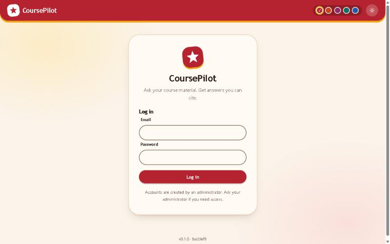{width=100%}

## Signing in

1. Open the address your administrator gave you (for example `http://localhost:8000`).
2. Enter your **email** and **password**, then press **Log in**.
3. A wrong email, wrong password or deactivated account all give the same message on purpose. Repeated failures are rate limited; wait a minute and try again.

## First login: choose your own password

If an administrator created your account, or reset your password, you must change it at your first sign-in. Until you do, you can only reach the change-password page, sign-out and static files.

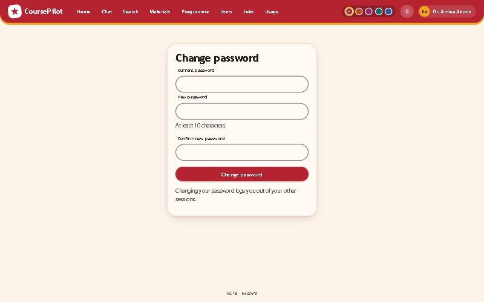{width=100%}

1. Enter the **current password** (the temporary one you were given).
2. Enter a **new password** (at least 10 characters, not your email, not a common password) and confirm it.
3. Press the change button. Your other sessions are signed out.

You can change your password again any time from the **Change password** link in the footer.

## Themes, accent colours and phones

The top bar has a **sun/moon button** for the dark or light theme and a row of **five coloured dots** to choose an accent colour (crimson, coral, plum, teal, ocean). Your choice is remembered in your browser. If you never choose, CoursePilot follows your device's light or dark setting.

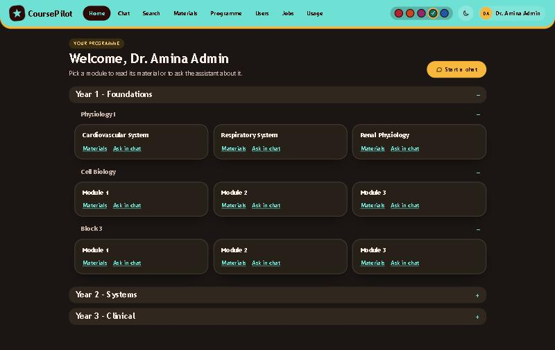{width=100%}

CoursePilot works on phones. On narrow screens the navigation moves behind a **menu button**.

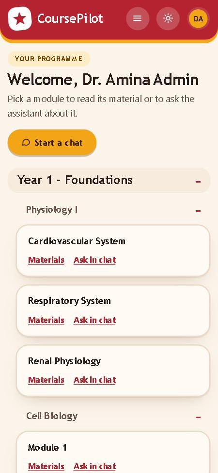{width=45%}

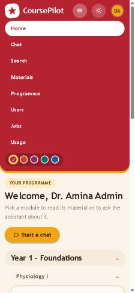{width=45%}

## The top bar

Across the top you see: **Home**, **Chat**, **Search**, **Materials** and **Programme** for everyone with an account, plus **Users**, **Jobs** and **Usage** for administrators. Guests only see **Chat** and **Search**, and a badge with their module and the time their access ends. At the right are the theme button and your name. The page footer shows the version and a link to change your password.

# For students

**Who: Students (also useful for Faculty and Administrators, who can chat too).**

## Home: browsing the programme

**What it is for:** to see which modules exist and which documents each contains.

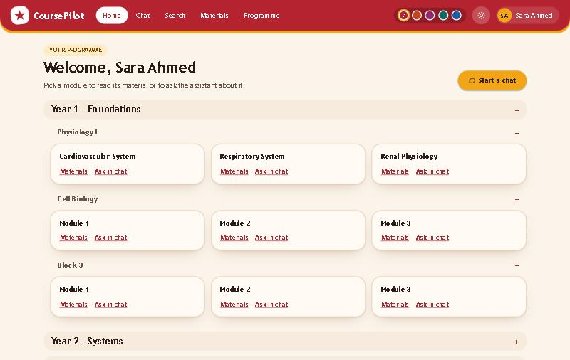{width=100%}

**What you see:** a "Welcome" heading, a **Start a chat** button, and the programme as expandable years and blocks. Each module has a **Materials** link (its documents, which you can open or download) and an **Ask in chat** link that opens a chat about that module.

## Chat

**What it is for:** asking questions and getting an answer built from your course material, with sources.

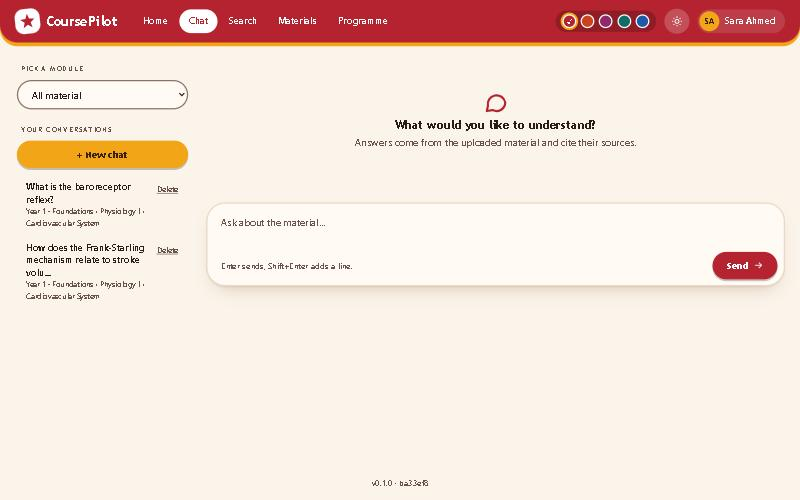{width=100%}

**What you see:**

- **Pick a module** (left): choose one module, or **All material** to search everything. The line under it shows the module's Year › Block › Module path.
- **Your conversations** (left): your earlier chats, each with a **Delete** link, and a **+ New chat** button.
- The **message box** at the bottom. Press **Enter** to send, **Shift+Enter** for a new line.

### Asking a question

1. Open **Chat**.
2. Choose a module in **Pick a module**, or **All material**.
3. Type your question and press **Enter** or **Send**.
4. Watch the **status lines** while the answer streams in, such as "Searching Module 2...", "Widening search to the whole block..." or "Searching the web...". They show where the assistant is looking.
5. Ask follow-up questions in the same conversation. The assistant understands "and what changes in heart failure?" from the earlier messages.

![An answer with citation chips ([C1], [C2]), a "Sources from the material" list, and Helpful / Not helpful buttons. The answer text is an example from a test model.](img/04-chat-answer.jpg){width=100%}

### Reading the citations

Every factual statement should carry a marker.

- **`C1`, `C2`... chips** point to your course material. Below the answer, **Sources from the material** lists each cited document with its page or slide and its Year › Block › Module path.
- **`W1`, `W2`... chips** point to web pages and appear in a separate, clearly labelled **From the web** block (see below).

### The citation side panel

Click a `C` chip to open a side panel with the exact passage the answer relied on.

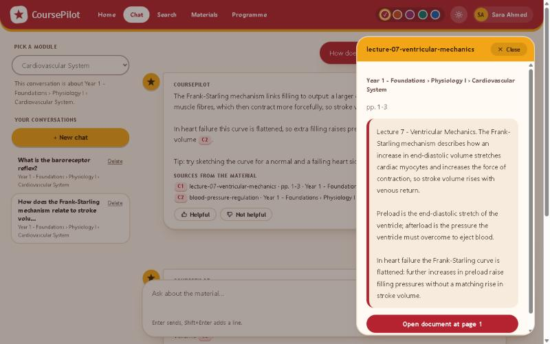{width=100%}

1. Click the chip (for example `C1`).
2. Read the **document title**, the **Year › Block › Module path**, the **page or slide**, and the **passage**.
3. Choose **Open document at page N** to open the original file at that page (PDFs open at the page; other formats download).
4. Close the panel with the close button or the **Esc** key.

Always check the passage when something matters, for example before an exam or assignment.

### The "From the web" block

If the material, searched step by step, cannot answer your question, and web search is allowed for the module, the assistant may search the internet. In that case the answer contains a separate **From the web** section with `W` chips. Click one to see the site, title and address; it opens in a new tab. Things to know:

- Web content is **not** from your course. If the web contradicts the material, the assistant says so and prefers the material for anything graded.
- If the assistant could not find anything relevant anywhere, it says so plainly rather than guessing.
- Web search can be switched off per module by faculty, or may not be set up at all on your installation.

### Feedback

Under each answer, press **Helpful** or **Not helpful**. This helps administrators and faculty improve the material. Administrators see the rated answer, your question and your comment, but **not who you are**, and not the rest of your conversation.

### Managing conversations

- Click a conversation in the left list to reopen it.
- Click **Delete** next to a conversation to remove it permanently, including its memory. Your conversations are private: no other user, administrators included, can open them.

### Limits

To keep costs under control each user may send a limited number of messages per day (the exact limit is set by your administrator; the default is 100) and a limited number per minute. If you reach the daily limit you will see that you have used your daily message limit; it resets at 00:00 UTC. If you send messages too quickly, wait the number of seconds shown and try again. Only one answer per user is generated at a time.

## Search

**What it is for:** finding passages directly, without an AI-written answer. Good for locating "where was this covered?"

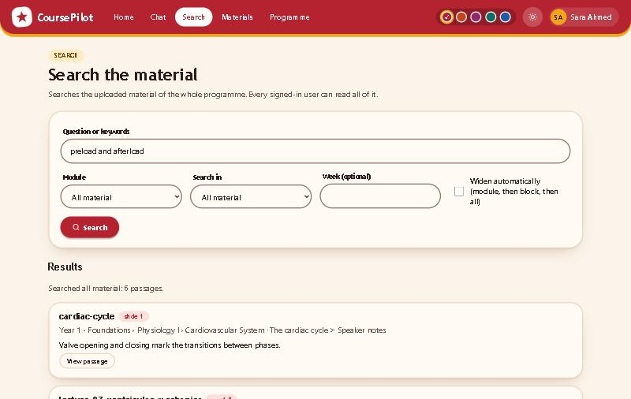{width=100%}

**What you see:** a **Question or keywords** box, a **Module** list, **Search in** (module, block or all), an optional **Week** filter, and a **Widen automatically (module, then block, then all)** checkbox.

1. Open **Search**.
2. Type your question or keywords.
3. Choose a module and what to search in. Tick **Widen automatically** if you want the search to widen from the module to its block and then to everything when nothing good is found.
4. Press **Search**.
5. Press **View passage** on a result to open the full passage and a link to the document.

# For faculty

**Who: Faculty.**

Faculty can do everything students can, plus manage the material. Whatever you upload can be read by **every user of the site**.

## Materials index

**What it is for:** choosing the module you want to upload to or manage.

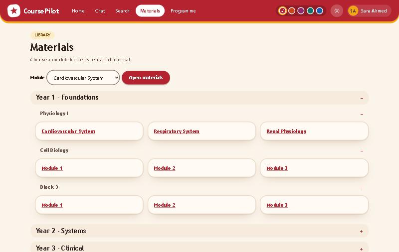{width=100%}

Open **Materials** in the top bar and choose a module.

## Uploading material

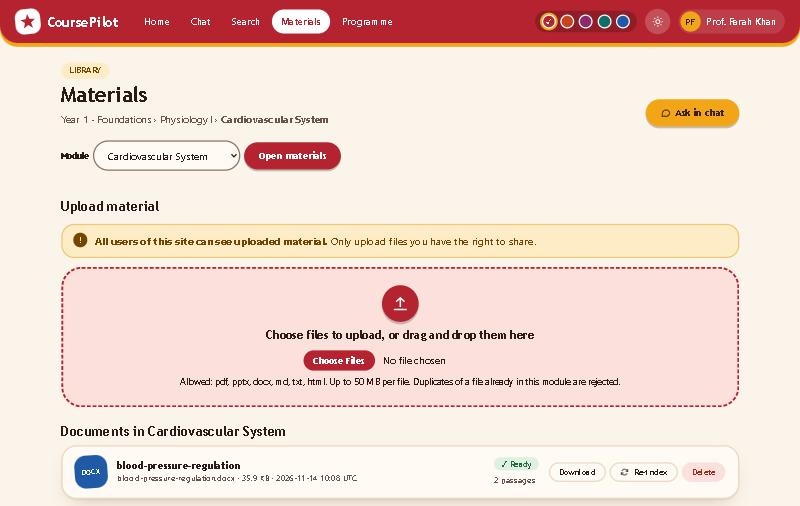{width=100%}

**What you see:**

- A yellow notice: **"All users of this site can see uploaded material. Only upload files you have the right to share."** Read it before choosing files.
- A dashed **drop zone** with a **Choose files** button.
- The list of **Documents in this module**.

**Allowed files:** PDF, PPTX, DOCX, MD, TXT and HTML, up to **50 MB per file**. The file's real content is checked, not only its extension. A file already in the same module (same content) is rejected as a duplicate.

To upload:

1. Open **Materials** and choose the module.
2. Drag files onto the drop zone, or press **Choose files** and select them (you can pick several).
3. Each file shows its own progress. When the upload finishes, the document appears in the list.
4. The list refreshes by itself every few seconds while documents are being processed.

## Understanding statuses

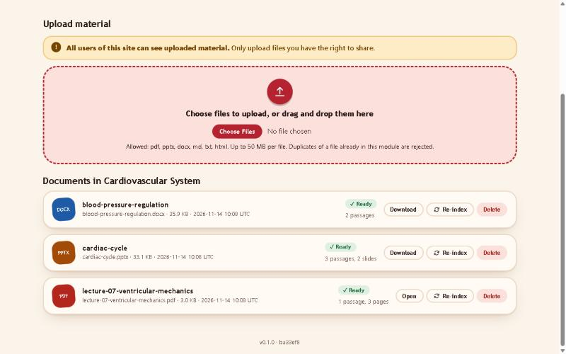{width=100%}

Each card shows the title, original filename, size and upload time, a **status badge**, and how many **passages** (searchable pieces) it was split into, plus pages or slides.

| Status | Meaning |
|---|---|
| **Queued** | Uploaded and waiting for the background worker. |
| **Processing** | The worker is reading the file, splitting it into passages and indexing it. |
| **Ready** | Searchable. Students can now get answers and citations from it. |
| **Failed** | Processing did not work. The card shows the reason. |
| **Re-indexing** | A **Ready** document is being re-processed. It stays searchable with its old passages until the new ones are ready. |

If a document stays **Queued** for a long time, the worker is probably not running (see Troubleshooting).

## When a document fails

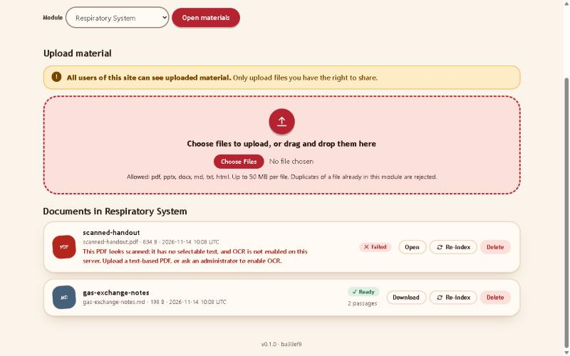{width=100%}

Read the message on the card. Typical reasons:

- **"This PDF looks scanned"**: the PDF is only page images with no selectable text, and OCR (text recognition) is not enabled. Re-export the PDF from the original source with text, or run OCR on it first, then upload it again. Your administrator can also enable OCR in the settings.
- **A missing or invalid AI key**: processing needs the embedding key. Ask the administrator to set it, then press **Re-index**.
- **A file that is too large, corrupt or has too many pages.**

After fixing the cause, upload a corrected file, or press **Re-index** on the card if the file itself is fine.

## Re-index and delete

- **Download** (or **Open** for PDFs) gets the original file.
- **Re-index** processes the file again (useful after an AI key was fixed). The document stays searchable meanwhile. If re-indexing fails, the old passages stay and the error is shown.
- **Delete** removes the document, its passages and the stored file. It first disappears from lists and search, then is cleaned up by the worker. This cannot be undone.

## Programme page: modules

**What it is for:** giving each module a clear title and description, and deciding whether web search is allowed.

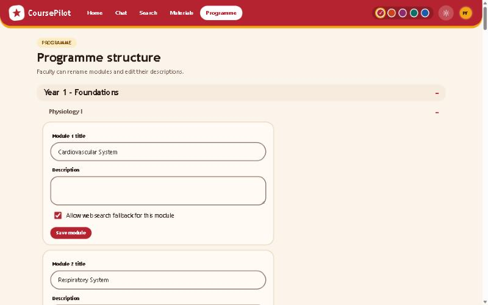{width=100%}

1. Open **Programme**.
2. Find the module. Edit **Module N title** and **Description**.
3. Tick or untick **Allow web search fallback for this module**. When unticked, the assistant never searches the internet for questions in this module.
4. Press **Save module**.

Faculty can rename modules; renaming years and blocks is for administrators.

## Temporary access codes

**Who: Faculty, Administrators.**

**What it is for:** letting people without an account (for example visitors, external examiners or a revision session) chat with the assistant about **one module** for a limited time.

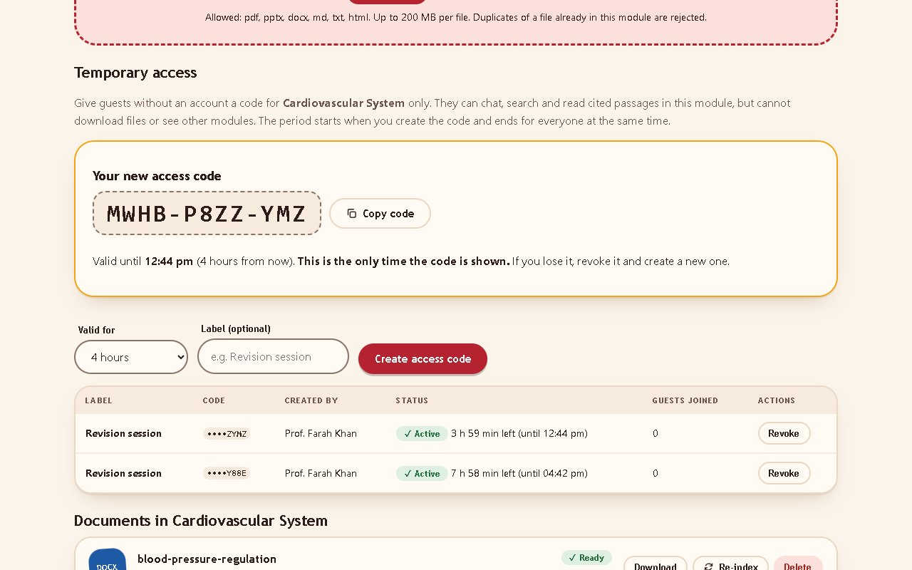{width=100%}

**Create a code**

1. Open the module's **Materials** page (from **Materials**, or the **Temporary access** link on the module's card on the Home page).
2. In **Temporary access**, choose how long the code is valid: **2, 4, 8, 10, 12 or 24 hours**. The period starts **now**, when you press the button, and ends for everyone at the same moment. A code created at 09:00 for 4 hours works until 13:00.
3. Optionally type a **Label** (for example "Revision session") to recognise the code later.
4. Press **Create access code**.
5. The code appears in a large box, for example `ABCD-EFGH-JKM`, with the time it is valid until. Press **Copy code** and share it with your guests.

> **The code is shown only once.** CoursePilot stores only a scrambled form of it. If you lose it, revoke it and create a new one.

**What guests can and cannot do.** With the code a guest can chat with the assistant, search and open cited passages **in this module only**. Guests cannot download documents, see other modules, upload, or open any administration page. Their conversations are deleted about an hour after their access ends.

**See and end codes.** The table under the form lists active codes and those that ended in the last few days: the label, the last four characters, who created it, whether it is active (with the time left), expired or revoked, and how many guests joined. To end a code early press **Revoke**, then **Yes, revoke the code**. Everyone who joined with it loses access immediately.

**When time runs out.** Access also ends on its own at the expiry time: the next thing a guest does shows "Your temporary access has ended."

# For administrators

**Who: Administrators.**

## Users

**What it is for:** creating accounts and managing who can sign in.

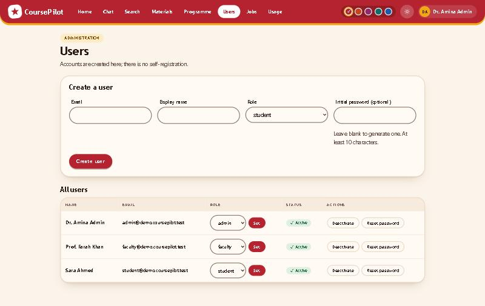{width=100%}

**Create a user**

1. Open **Users**.
2. Fill in **Email**, **Display name** and **Role** (student, faculty or admin).
3. Optionally enter an **Initial password** (at least 10 characters). If you leave it blank, CoursePilot generates a temporary password and shows it **once**; copy it and give it to the person securely.
4. Press **Create user**. The user must choose their own password at first sign-in.

**Manage users**

- **Role:** pick a role in the list and press **Set**.
- **Deactivate / Reactivate:** a deactivated user cannot sign in and is signed out everywhere. Accounts are never deleted, so history is kept.
- **Reset password:** generates a new temporary password (shown once, never stored in readable form). The user is signed out and must choose a new password.
- **Safety rules:** you cannot deactivate or demote yourself, and the **last active administrator** can never be removed.

Forgot-password requests go to an administrator, who uses **Reset password**.

## Programme structure

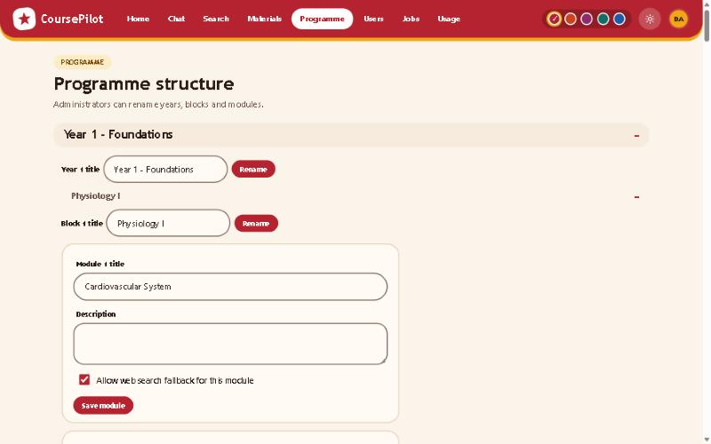{width=100%}

Open **Programme** and edit the title of any **year** or **block** and press **Rename**; modules have the same fields as in the faculty view (title, description, web-search setting). The number of years, blocks and modules is fixed by the installation settings (default 3 x 3 x 3), not changed on this page.

## Jobs

**What it is for:** following the background work (processing, re-indexing and deletion of documents).

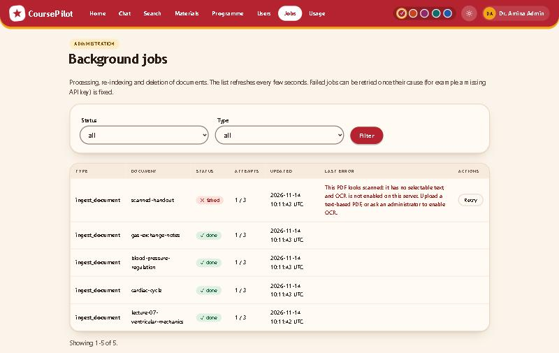{width=100%}

Jobs are **queued**, **running**, **done** or **failed**. The list refreshes every few seconds. Failed jobs show their error with secrets removed. Interrupted jobs are retried automatically with increasing delays before they are marked failed.

To retry a failed job:

1. Fix the cause first (for example set the missing API key in `.env` and restart).
2. Press **Retry** on the job. Only failed jobs can be retried. This resets its attempts and queues it again.

## Usage

**What it is for:** seeing how much the system is used and what it costs.

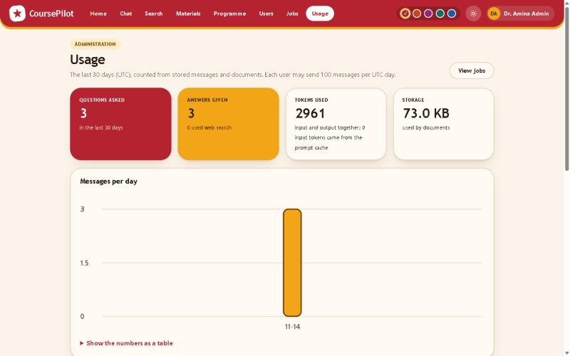{width=100%}

At the top are summary **tiles** and a **messages per day** chart (UTC days, last 30 days by default).

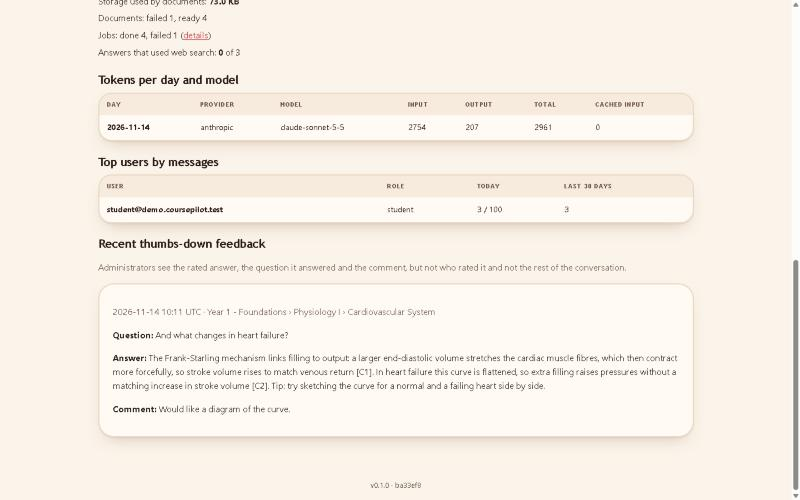{width=100%}

Further down:

- **Tokens per day and model**: how much text was sent to and produced by the AI, including **cached** tokens (cheaper repeated parts of prompts).
- **Documents and jobs by status**, **storage used**, and how many answers used **web search**.
- **Top users**: message counts by email (counts only, no content) with today's use against the daily limit. Guests (people who joined with an access code) are not listed one by one; they appear together in a single **Guests (temporary access)** row with their combined message counts.
- **Feedback**: answers rated **Not helpful** (or helpful), with the question and any comment.

> **Privacy.** Conversations stay private to their owners. The feedback list shows a rated answer, its question and comment, but **not who rated it** and not the rest of the conversation.

# For guests: joining with an access code

**Who: Guests (no account).**

## Joining with an access code

Your instructor gives you a code such as `ABCD-EFGH-JKM`. Capital letters, small letters, spaces and dashes do not matter.

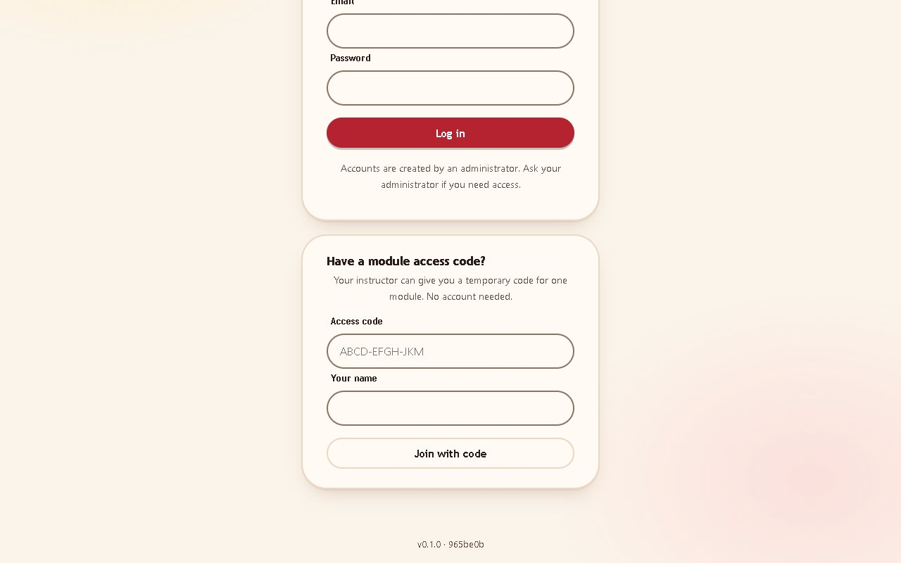{width=100%}

1. Open the CoursePilot address you were given. Below the sign-in form find **Have a module access code?**
2. Type the **Access code** and **Your name** (up to 40 characters; it is shown in the top bar and nowhere else).
3. Press **Join with code**. You land on the Chat page.

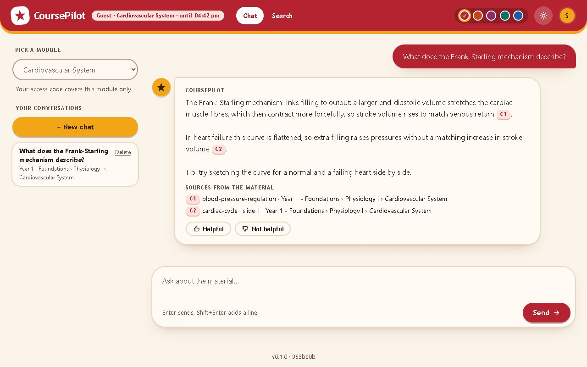{width=100%}

## What you can do

- **Chat** with the assistant about the module named in the top bar. Answers come from that module's material and cite their sources; the module cannot be changed.
- **Search** the module's material.
- **Click a citation** such as `[C1]` to read the passage. As a guest you can read the passage but there is no link to open or download the document.
- The top bar shows **Guest · module · until HH:MM** (in your own time zone). When that time passes, or the instructor ends the code, you are signed out and see "Your temporary access has ended."

Your conversations are deleted shortly after your access ends. Copy anything you want to keep before then. To leave earlier, open the menu with your name and press **Log out**.

# How answers are produced

In plain terms, for every question the assistant follows the same fixed path:

1. **Understand the question.** A follow-up such as "and what about heart failure?" is rewritten into a complete question using the recent conversation.
2. **Search the selected module.** It looks for the best matching passages (by meaning and by keywords). An answer can combine several documents, for example a case guide for the scenario details and a textbook for the underlying explanation.
3. **Widen if needed.** If the module does not contain enough, it widens to the whole block, then to all material.
4. **Only then, the web.** If nothing in the material is good enough, and web search is available for the module, it may search the internet.
5. **Write the answer** using only the numbered sources it was given, with `[C#]` markers for material and `[W#]` for web pages.
6. **Check the citations.** Markers that do not match a real source are removed, and only the sources actually cited are shown.

Text inside uploaded documents and web pages is treated as information, never as instructions, so a document cannot "tell" the assistant what to do. The assistant is also designed to encourage learning rather than simply hand over answers to assignments.

# Troubleshooting and FAQ

**The chat says "AI provider not configured."**
No API key is set for the chat provider. An administrator should run setup again (or edit `.env`), enter the key, and restart CoursePilot.

**A document shows Failed with "This PDF looks scanned."**
The PDF has no selectable text. Re-export it with text or OCR it first, then upload again (or ask your administrator to enable OCR).

**A document stays Queued.**
The worker is not running. If you use `start.bat` / `./start.sh` both run together; check the terminal for errors. A missing embedding key also makes documents fail; set it, then press **Re-index** or **Retry** on the job.

**After changing the embedding provider, search or chat reports an index mismatch.**
Vectors built with one embedding model cannot be searched with another. Stop CoursePilot and run, from the `backend` folder, `python -m uv run python -m app.cli reindex-all`. It rebuilds the index and re-processes all documents; they show as Queued/Processing until finished.

**I get "forbidden" when saving something, or login fails, on a LAN.**
You are probably using a different address from the one configured (for example the computer name instead of the IP address). Everyone must use exactly the address saved in setup (`BASE_URL` in `.env`). Run setup again if the address changed.

**"Rate limited" or "daily limit" messages.**
You sent messages too fast (wait the number of seconds shown) or used your daily message allowance (resets at 00:00 UTC). An administrator can raise the limits in `.env` (`CHAT_RATE_LIMIT_PER_MIN`, `CHAT_DAILY_LIMIT_PER_USER`).

**I forgot my password.**
Ask an administrator to use **Reset password** on the Users page. You will get a temporary password and must choose a new one.

**Where are the logs?**
When you use `start.bat` / `./start.sh`, logs appear in the terminal as structured lines (passwords, keys and prompts are not logged). Production services write to your service manager's logs; see `docs/deploy.md`.

**A guest says "That access code is not valid or has expired."**
The code was typed wrongly, has expired, or was revoked. For safety the message is the same in all three cases. Check the code (case, spaces and dashes do not matter), then ask faculty or an administrator for a new code if it still fails. After several wrong attempts in a minute you must wait a minute before trying again.

**A guest sees "Your temporary access has ended."**
The code expired or was revoked. Ask for a new code and join again; earlier conversations are not kept.

**I lost the access code I just created.**
Codes are shown only once. Open the module's Materials page, **Revoke** the old code and create a new one.

**Can I see other people's conversations?**
No. Conversations are private to their owner, even from administrators.

**Why can everyone see uploaded files?**
By design, every signed-in user with an account can read all uploaded material (guests only the one module of their code). Only upload what you have the right to share.

# Glossary

**Block**: a group of modules inside a year.

**Chunk / passage**: a searchable piece of a document (roughly a few paragraphs or one slide).

**Citation**: a marker such as `[C1]` (course material) or `[W1]` (web) linking a statement to its source.

**Embedding**: a numeric representation of text meaning, used to find passages similar to a question.

**Index / re-index**: preparing a document for search; doing it again for the same document.

**Job**: a unit of background work such as processing a document.

**Module**: a course unit inside a block; the place documents are uploaded.

**Programme**: the whole structure of Years, Blocks and Modules.

**Worker**: the background process that parses, splits and indexes uploaded files.

**Web fallback**: the labelled internet search used only when the material cannot answer.
